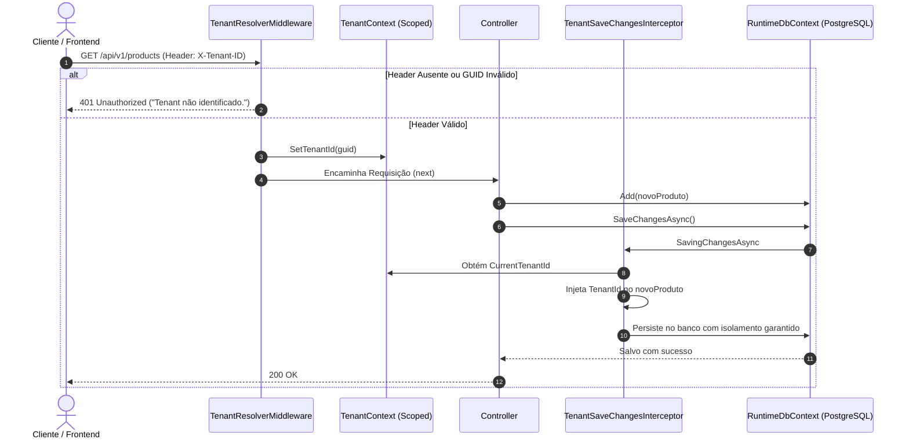

# Arquitetura e Federação de Dados - ArkenERP Backend

> **Módulo**: Núcleo de Arquitetura e Multi-Tenancy  
> **Sistema**: ArkenERPCore  
> **Data**: Outubro/2026  

---

## 1. Topologia da Federação Dual-Database

O ecossistema Arken adota uma separação intencional de preocupações entre **Governança/Tenancy** e **Runtime Operacional/IA**. Essa abordagem protege os dados dos clientes e otimiza os recursos computacionais para consultas analíticas e vetoriais de IA.

```text
┌──────────────────────────────────────────────────────────────────────────────┐
│                              API Gateway / Client                            │
└──────────────────────────────────────┬───────────────────────────────────────┘
                                       │ HTTP + Header 'X-Tenant-ID'
                                       ▼
┌──────────────────────────────────────────────────────────────────────────────┐
│                       ASP.NET Core Web API (ArkenERPCore)                    │
│                                                                              │
│  [TenantResolverMiddleware] ──► Extrai e valida TenantId (GUID)              │
│  [TenantContext (Scoped)]   ──► Mantém imutabilidade por escopo             │
│  [TenantSaveChangesInterceptor] ──► Injeta TenantId em entidades adicionadas │
└───────────────────────────┬──────────────────────┬───────────────────────────┘
                            │                      │
       ManagerDbContext     │                      │   RuntimeDbContext
       (Pomelo MySQL)       │                      │   (Npgsql PostgreSQL 16)
                            ▼                      ▼
      ┌───────────────────────────┐      ┌───────────────────────────────────┐
      │         MySQL 8           │      │       PostgreSQL 16 Engine        │
      │       arken_manage        │      │          arken_runtime            │
      ├───────────────────────────┤      ├───────────────────────────────────┤
      │ • tenants                 │      │ • clients, products, orders       │
      │ • tenant_users            │◄────┐│ • ai_agents, ai_conversations     │
      │ • users & sessions        │ mysql│ • ai_memories (pgvector)          │
      │ • roles & permissions     │  fdw │ • semantic_cache (pgvector)       │
      │ • audit_logs              │      │ • business_insights, BI visuals   │
      └───────────────────────────┘      └───────────────────────────────────┘
```

---

## 2. Por que Dual-Database (MySQL + PostgreSQL com FDW)?

1. **MySQL 8 (`arken_manage`)**:
   - Ideal para transações de alta frequência em operações administrativas, controle fino de sessões e compatibilidade com provedores de identidade legados e sistemas de faturamento externos (ex.: Stripe).
   - Mapeado com exclusividade pelo [`ManagerDbContext.cs`](file:///e:/Projects/Lucas/arken-dev/backend/ArkenERPCore/ArkenERP.Lib/Context/ManagerDbContext.cs).

2. **PostgreSQL 16 (`arken_runtime`)**:
   - Integra a extensão nativa de vetores ([`pgvector`](file:///e:/Projects/Lucas/arken-dev/db/postgre/Dockerfile)) para permitir busca semântica veloz diretamente no banco de dados relacional sem necessitar de um banco vetorial externo separado (ex: Pinecone, Qdrant).
   - Possui suporte a esquemas dinâmicos, tipos JSONB de alta performance para os layouts flexíveis do frontend e enums nativos de banco.
   - Mapeado pelo [`RuntimeDbContext.cs`](file:///e:/Projects/Lucas/arken-dev/backend/ArkenERPCore/ArkenERP.Lib/Context/RuntimeDbContext.cs).

3. **Foreign Data Wrapper (`mysql_fdw`)**:
   - Instalado diretamente na imagem Docker do PostgreSQL ([`db/postgre/Dockerfile`](file:///e:/Projects/Lucas/arken-dev/db/postgre/Dockerfile)).
   - Permite que o PostgreSQL monte tabelas estrangeiras (*foreign tables*) consultando diretamente o MySQL sem tráfego de rede complexo via aplicação quando agentes analíticos de IA precisarem cruzar dados de tenant com dados operacionais de vendas.

---

## 3. Ciclo de Vida da Segurança Multi-Tenancy

O isolamento é aplicado em cascata durante todo o fluxo da requisição:



### Detalhes das Classes Envolvidas:
- [`TenantResolverMiddleware.cs`](file:///e:/Projects/Lucas/arken-dev/backend/ArkenERPCore/ArkenERPCore/API/Middlewares/TenantResolverMiddleware.cs): Intercepta qualquer rota não-pública e rejeita imediatamente acessos sem cabeçalho.
- [`TenantContext.cs`](file:///e:/Projects/Lucas/arken-dev/backend/ArkenERPCore/ArkenERPCore/Security/TenantContext.cs): Implementa `ITenantContext`, validando unicidade e consistência durante todo o ciclo de vida do request.
- [`TenantSaveChangesInterceptor.cs`](file:///e:/Projects/Lucas/arken-dev/backend/ArkenERPCore/ArkenERPCore/Interceptors/TenantSaveChangesInterceptor.cs): Evita erro humano nas gravações do EF Core, preenchendo o `TenantId` em qualquer classe derivada de `TenantEntity`.

---

## 4. Estratégia de Nomenclatura Automática (`snake_case`)

Para garantir compatibilidade entre o código C# (que segue `PascalCase`) e os motores MySQL e PostgreSQL no Linux (que operam melhor em `snake_case`), ambos os DbContexts aplicam um algoritmo declarativo no método `OnModelCreating`:

```csharp
private static void ApplySnakeCase(ModelBuilder modelBuilder)
{
    foreach (var entity in modelBuilder.Model.GetEntityTypes())
    {
        entity.SetTableName(ToSnakeCase(entity.GetTableName()!));
        foreach (var property in entity.GetProperties())
            property.SetColumnName(ToSnakeCase(property.Name));
        foreach (var key in entity.GetKeys())
            key.SetName(ToSnakeCase(key.GetName()!));
        foreach (var key in entity.GetForeignKeys())
            key.SetConstraintName(ToSnakeCase(key.GetConstraintName()!));
        foreach (var index in entity.GetIndexes())
            index.SetDatabaseName(ToSnakeCase(index.GetDatabaseName()!));
    }
}
```

Isso garante consistência absoluta em todas as tabelas e chaves sem necessidade de anotações manuais `[Column("...")]` no domínio.
