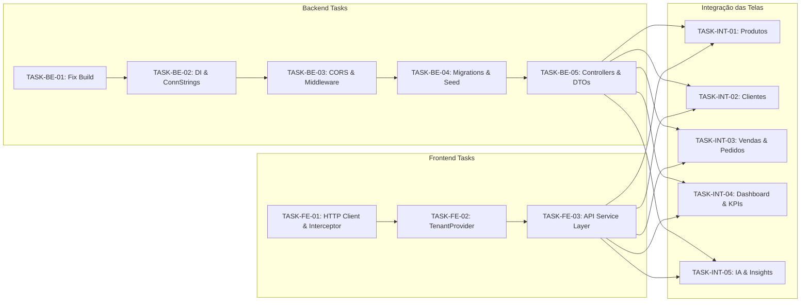

# Backlog de Sincronização Frontend ⇄ Backend - ArkenERP

> **Status**: Backlog Estruturado  
> **Frontend**: `frontend/arken-erp-lite` (React 19 + TypeScript + MUI v6)  
> **Backend**: `backend/ArkenERPCore` (ASP.NET Core 10 + EF Core 10 Dual-Database)  
> **Data**: Outubro/2026  

---

## 1. Visão Geral da Sincronização

Atualmente:
- O **Frontend** opera como uma SPA rica com componentes do mini-framework Arken, consumindo dados estáticos e mocks locais (`src/framework/data/*MockData.ts`).
- O **Backend** possui a modelagem de domínio completa e os DbContexts federados (MySQL + Postgres com `pgvector`), porém não possui os controllers REST implementados, CORS configurado, nem injeção dos DbContexts em `Program.cs`.

A sincronização consiste em transformar os fluxos mockados do frontend em chamadas HTTP REST autenticadas via header `X-Tenant-ID`, com DTOs desacoplados e controllers/serviços assíncronos no backend.

---

## 2. Quadro de Tasks de Sincronização

---

## 3. Detalhamento das Tasks

### FASE 1: Fundação e Prontidão do Backend

#### `[TASK-BE-01]` Correção dos Namespaces no Módulo Website
- **Camada**: Backend (`ArkenERP.Lib`)
- **Arquivos**:
  - [`Website.cs`](file:///e:/Projects/Lucas/arken-dev/backend/ArkenERPCore/ArkenERP.Lib/Domain/Runtime/Website/Website.cs)
  - [`WebsitePage.cs`](file:///e:/Projects/Lucas/arken-dev/backend/ArkenERPCore/ArkenERP.Lib/Domain/Runtime/Website/WebsitePage.cs)
  - [`WebsiteComponent.cs`](file:///e:/Projects/Lucas/arken-dev/backend/ArkenERPCore/ArkenERP.Lib/Domain/Runtime/Website/WebsiteComponent.cs)
  - [`WebsiteLayout.cs`](file:///e:/Projects/Lucas/arken-dev/backend/ArkenERPCore/ArkenERP.Lib/Domain/Runtime/Website/WebsiteLayout.cs)
  - [`WebsiteThemeConfig.cs`](file:///e:/Projects/Lucas/arken-dev/backend/ArkenERPCore/ArkenERP.Lib/Domain/Runtime/Website/WebsiteThemeConfig.cs)
  - [`SeoMetadata.cs`](file:///e:/Projects/Lucas/arken-dev/backend/ArkenERPCore/ArkenERP.Lib/Domain/Runtime/Website/SeoMetadata.cs)
- **Ação**: Substituir `using ArkenAPI.Domain.Entities.Base;` e `namespace ArkenAPI...` por referências a `ArkenERP.Lib.Domain...`.
- **Critério de Aceite**: `dotnet build ArkenERPCore.slnx` executa com 0 erros.

#### `[TASK-BE-02]` Injeção de DbContexts, Interceptor e Connection Strings
- **Camada**: Backend (`ArkenERPCore`)
- **Arquivos**:
  - [`Program.cs`](file:///e:/Projects/Lucas/arken-dev/backend/ArkenERPCore/ArkenERPCore/Program.cs)
  - [`appsettings.Development.json`](file:///e:/Projects/Lucas/arken-dev/backend/ArkenERPCore/ArkenERPCore/appsettings.Development.json)
- **Ação**:
  - Registrar `TenantSaveChangesInterceptor` no DI.
  - Registrar `ManagerDbContext` com `UseMySql(...)` usando Pomelo.
  - Registrar `RuntimeDbContext` com `UseNpgsql(...)`, `.UseVector()` e adicionando o interceptor.
  - Configurar strings de conexão apontando para as portas locais do Docker (`3306` MySQL e `5432` Postgres).
- **Critério de Aceite**: A aplicação inicializa e os contextos conectam com sucesso aos bancos locais.

#### `[TASK-BE-03]` Registro do Middleware Multi-Tenant e Configuração de CORS
- **Camada**: Backend (`ArkenERPCore`)
- **Arquivos**:
  - [`Program.cs`](file:///e:/Projects/Lucas/arken-dev/backend/ArkenERPCore/ArkenERPCore/Program.cs)
  - [`TenantResolverMiddleware.cs`](file:///e:/Projects/Lucas/arken-dev/backend/ArkenERPCore/ArkenERPCore/API/Middlewares/TenantResolverMiddleware.cs)
- **Ação**:
  - Habilitar política de CORS permitindo origem do Vite (`http://localhost:5173`) com headers liberados (`X-Tenant-ID`, `Authorization`, `Content-Type`).
  - Ativar `app.UseCors()` antes de mapear os controllers.
  - Inserir `app.UseMiddleware<TenantResolverMiddleware>()` no pipeline garantindo que rotas com `OPTIONS` passem sem bloqueio.
- **Critério de Aceite**: Requisições preflight `OPTIONS` respondem 200 OK e requisições GET com `X-Tenant-ID` são processadas.

#### `[TASK-BE-04]` Criação e Execução de Migrações Iniciais do EF Core
- **Camada**: Backend (`ArkenERP.Lib` / Bancos de Dados)
- **Ação**:
  - Criar migração do MySQL: `dotnet ef migrations add InitialManagerCreate --context ManagerDbContext`.
  - Criar migração do Postgres: `dotnet ef migrations add InitialRuntimeCreate --context RuntimeDbContext`.
  - Aplicar migrações nos bancos com `dotnet ef database update`.
- **Critério de Aceite**: Todas as tabelas e extensões (`pgvector`, `execution_status`) criadas nos bancos do container.

#### `[TASK-BE-05]` Seed de Dados de Desenvolvimento
- **Camada**: Backend (`ArkenERPCore`)
- **Ação**:
  - Criar script ou serviço de seed inicial que cadastra um Tenant padrão (ex: `Slug = "loja-modelo"`, `Id = 11111111-1111-1111-1111-111111111111`), categorias de produtos e os itens já presentes no mock do frontend.
- **Critério de Aceite**: Ao iniciar em ambiente Development, o banco já contém dados mínimos para exibição no frontend.

---

### FASE 2: Exposição da Camada de API REST no Backend

#### `[TASK-BE-06]` Controllers e DTOs de Produtos e Categorias
- **Camada**: Backend (`ArkenERPCore/Controllers`)
- **Ação**:
  - Criar `ProductsController.cs` e `CategoriesController.cs`.
  - Implementar endpoints:
    - `GET /api/v1/products`: Lista paginada com busca por termo e filtro de categoria.
    - `GET /api/v1/products/{id}`: Detalhes do produto.
    - `POST /api/v1/products`: Criação de produto.
    - `PUT /api/v1/products/{id}`: Atualização de produto e estoque.
    - `DELETE /api/v1/products/{id}`: Inativação/exclusão lógica.
- **Critério de Aceite**: DTO de resposta compatível com a interface `CatalogProduct` do frontend.

#### `[TASK-BE-07]` Controllers e DTOs de Clientes
- **Camada**: Backend (`ArkenERPCore/Controllers`)
- **Ação**:
  - Criar `CustomersController.cs`.
  - Implementar endpoints:
    - `GET /api/v1/customers`: Lista com filtros de status e busca.
    - `GET /api/v1/customers/{id}`: Perfil completo com métricas consolidadas (total gasto, ticket médio, últimos produtos comprados).
    - `POST /api/v1/customers`: Cadastro de cliente.
    - `PUT /api/v1/customers/{id}`: Atualização cadastral.
- **Critério de Aceite**: DTO de resposta compatível com as interfaces `CustomerItem` e `CustomerDetailData`.

#### `[TASK-BE-08]` Controllers e DTOs de Vendas e Pedidos
- **Camada**: Backend (`ArkenERPCore/Controllers`)
- **Ação**:
  - Criar `SalesController.cs` e `OrdersController.cs`.
  - Implementar endpoints:
    - `GET /api/v1/sales`: Listagem de transações com status e período.
    - `GET /api/v1/sales/metrics`: KPIs consolidados de faturamento, pedidos e ticket médio.
    - `POST /api/v1/orders`: Criação de novo pedido.
- **Critério de Aceite**: Retorno compatível com a tabela de vendas e KPIs da página de vendas.

#### `[TASK-BE-09]` Controller de IA e Insights Preditivos
- **Camada**: Backend (`ArkenERPCore/Controllers`)
- **Ação**:
  - Criar `AiController.cs`.
  - Implementar endpoints:
    - `GET /api/v1/ai/insights`: Retorna lista de insights proativos (`BusinessInsight`).
    - `POST /api/v1/ai/insights/{id}/apply`: Marca insight como aplicado.
    - `POST /api/v1/ai/insights/{id}/dismiss`: Descarta insight.
    - `POST /api/v1/ai/chat`: Envia mensagem para o agente e recebe resposta (integrado com histórico `AiConversation` e `AiMessage`).
- **Critério de Aceite**: O frontend consome insights reais no `SalesAICard` e responde no `AIAssistantDrawer`.

---

### FASE 3: Camada de Integração HTTP no Frontend

#### `[TASK-FE-01]` Cliente HTTP Centralizado e Interceptors
- **Camada**: Frontend (`frontend/arken-erp-lite/src/services/api/`)
- **Arquivos a Criar**:
  - `src/services/api/client.ts`
  - `src/services/api/endpoints.ts`
- **Ação**:
  - Configurar instância do cliente HTTP apontando para `VITE_API_URL` (padrão: `http://localhost:5024`).
  - Adicionar interceptor de request que injeta automaticamente o cabeçalho `X-Tenant-ID` obtido do armazenamento local ou do contexto da aplicação.
  - Adicionar interceptor de response para tratamento global de erros (ex: 401 redireciona ou notifica tenant inválido).
- **Critério de Aceite**: Todas as chamadas HTTP saem com o cabeçalho `X-Tenant-ID` configurado.

#### `[TASK-FE-02]` Contexto de Tenant e Armazenamento no Frontend
- **Camada**: Frontend (`frontend/arken-erp-lite/src/framework/`)
- **Arquivos a Criar**:
  - `src/framework/context/TenantContext.tsx`
- **Ação**:
  - Criar React Context `TenantContext` contendo `tenantId`, `tenantSlug` e função `setTenantId`.
  - Inicializar com um tenant padrão de desenvolvimento salvo em `localStorage`.
- **Critério de Aceite**: A aplicação sabe qual inquilino está ativo em toda a árvore de componentes.

#### `[TASK-FE-03]` Criação dos Serviços de API Tipados
- **Camada**: Frontend (`frontend/arken-erp-lite/src/services/`)
- **Arquivos a Criar**:
  - `productService.ts`: Chamadas para `/api/v1/products`.
  - `customerService.ts`: Chamadas para `/api/v1/customers`.
  - `salesService.ts`: Chamadas para `/api/v1/sales`.
  - `dashboardService.ts`: Chamadas para `/api/v1/dashboard`.
  - `aiService.ts`: Chamadas para `/api/v1/ai`.
- **Ação**:
  - Funções assíncronas tipadas com TypeScript (`Promise<CatalogProduct[]>`, etc.) com fallback amigável em caso de erro de rede.
- **Critério de Aceite**: Serviços exportam métodos reutilizáveis sem acoplamento a componentes visuais.

---

### FASE 4: Conexão das Telas (Substituição de Mocks)

#### `[TASK-INT-01]` Integração da Tela de Produtos
- **Camada**: Frontend (`frontend/arken-erp-lite/src/pages/ProductsPage.tsx`)
- **Ação**:
  - Substituir importação de `catalogProducts` por hook assíncrono `useEffect` chamando `productService.getProducts()`.
  - Implementar estado de loading e feedback de erro.
  - Conectar ações do modal (criar produto, editar, atualizar estoque) aos métodos POST/PUT da API.
- **Critério de Aceite**: A listagem de produtos e os filtros exibem registros vindos do banco de dados PostgreSQL.

#### `[TASK-INT-02]` Integração da Tela de Clientes
- **Camada**: Frontend (`frontend/arken-erp-lite/src/pages/CustomersPage.tsx`)
- **Ação**:
  - Conectar a tabela de clientes ao `customerService.getCustomers()`.
  - Ao clicar em um cliente, carregar os detalhes reais do `customerService.getCustomerById(id)` no [`CustomerDetailCard.tsx`](file:///e:/Projects/Lucas/arken-dev/frontend/arken-erp-lite/src/framework/components/cards/CustomerDetailCard.tsx).
- **Critério de Aceite**: Dados do cliente e métricas de compras alimentadas pela API.

#### `[TASK-INT-03]` Integração da Tela de Vendas e Pedidos
- **Camada**: Frontend (`frontend/arken-erp-lite/src/pages/SalesPage.tsx`)
- **Ação**:
  - Conectar KPIs e tabela de pedidos ao `salesService.getSales()`.
  - Conectar o card de detalhe do pedido [`OrderDetailsCard.tsx`](file:///e:/Projects/Lucas/arken-dev/frontend/arken-erp-lite/src/framework/components/cards/OrderDetailsCard.tsx) ao endpoint de detalhes.
- **Critério de Aceite**: Registros transacionais de vendas sincronizados em tempo real.

#### `[TASK-INT-04]` Integração do Dashboard Principal
- **Camada**: Frontend (`frontend/arken-erp-lite/src/pages/DashboardPage.tsx`)
- **Ação**:
  - Conectar os cards de KPIs superiores (`KpiCard`) aos valores agregados calculados pelo backend.
  - Conectar gráficos de faturamento e fluxo de caixa aos dados reais de vendas e pedidos.
- **Critério de Aceite**: Gráficos e números do dashboard refletem a soma real dos registros persistidos.

#### `[TASK-INT-05]` Integração dos Módulos de IA e Recomendações
- **Camada**: Frontend (`AIAssistantDrawer.tsx`, `SalesAICard.tsx`, `FinanceAICard.tsx`)
- **Ação**:
  - Conectar os cards de IA da página de vendas e financeiro ao endpoint `/api/v1/ai/insights`.
  - Implementar ações dos botões "Aplicar Otimização" chamando `/api/v1/ai/insights/{id}/apply`.
  - Conectar o drawer de chat lateral à conversa interativa com o backend.
- **Critério de Aceite**: Insights gerados dinamicamente e mensagens trocadas com o agente persistidas no banco.

---

### FASE 5: Homologação e Testes End-to-End

#### `[TASK-E2E-01]` Validação do Fluxo Integrado Completo
- **Ação**:
  - Subir containers com `docker compose up -d`.
  - Iniciar backend na porta `5024` com `dotnet run`.
  - Iniciar frontend com `yarn dev` ou `npm run dev`.
  - Realizar o ciclo completo: Criar um produto no frontend -> Verificar inserção na tabela `products` do PostgreSQL -> Abrir dashboard e validar atualização do estoque e KPIs.
- **Critério de Aceite**: Zero erros de CORS, zero erros 401 e dados persistidos com o `TenantId` correto.
