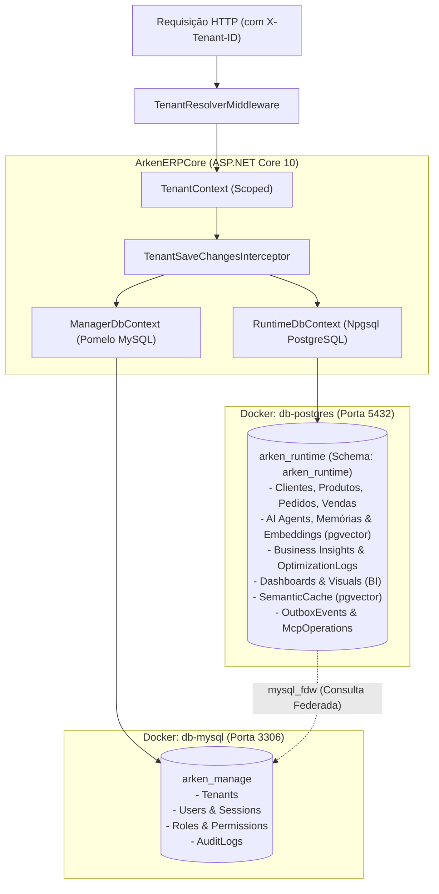

# Documentação Técnica Completa - ArkenERP Backend (ArkenERPCore)

> **Versão**: 1.0.0-preview  
> **Status**: Em Desenvolvimento / Base de Domínio e Multi-Tenancy Estruturados  
> **Framework & Runtime**: .NET 10.0 (`net10.0`) / ASP.NET Core Web API  
> **Arquitetura de Dados**: Dual-Database Federada (MySQL 8 + PostgreSQL 16 com `pgvector` e `mysql_fdw`)  
> **Isolamento**: Multi-Tenancy lógico e transacional com resolução por Header `X-Tenant-ID` e interceptação automática no EF Core  

---

## 1. Visão Geral do Sistema

O backend do ecossistema **ArkenERP** (denominado [ArkenERPCore](file:///e:/Projects/Lucas/arken-dev/backend/ArkenERPCore)) é o núcleo transacional e analítico corporativo projetado para sustentar uma plataforma ERP inteligente, modular e multi-inquilino (*multi-tenant*).

O sistema adota uma abordagem moderna de **banco de dados federado**:
1. **Gerenciamento Global e Identidade (MySQL)**: Responsável pelo controle de tenants, assinaturas, usuários globais, papéis (*roles*), permissões e auditoria administrativa.
2. **Runtime Operacional, IA & BI (PostgreSQL 16)**: Atua como o "Maestro da Federação", contendo o banco de dados operacional dos tenants, registros de ERP (clientes, produtos, pedidos, vendas), mecanismos vetoriais para IA ([`pgvector`](file:///e:/Projects/Lucas/arken-dev/db/postgre/Dockerfile)), cache semântico de prompts, eventos de integração (*Outbox Pattern*), dashboards analíticos e histórico de execuções MCP (*Model Context Protocol*).

---

## 2. Stack Tecnológica

| Componente | Tecnologia | Versão | Função Principal |
| :--- | :--- | :--- | :--- |
| **Linguagem & Runtime** | C# 13 / .NET | `10.0` (preview) | Runtime de alta performance assíncrono |
| **Framework Web** | ASP.NET Core Web API | `10.0` | Exposição de endpoints REST e middlewares de segurança |
| **ORM / Acesso a Dados** | Entity Framework Core | `10.0.12` | Mapeamento objeto-relacional e interceptadores |
| **Banco MySQL (Manager)** | MySQL Community / Pomelo EFCore | `8.0` / `9.0.0` | Gerenciamento central, Tenancy e RBAC |
| **Banco PostgreSQL (Runtime)** | PostgreSQL + `pgvector` + `mysql_fdw` | `16` / Npgsql `10.0.3` | Motor de runtime, dados operacionais e IA vetorial |
| **Extensão Vetorial** | `Pgvector.EntityFrameworkCore` | `0.3.0` | Busca por similaridade de embeddings (384/1536 dim) |
| **Documentação da API** | Microsoft.AspNetCore.OpenApi / Swagger | `10.0.12` / `10.2.3` | Especificação OpenAPI com autenticação `X-Tenant-ID` |
| **Orquestração de Containers** | Docker & Docker Compose | Compose v2 | Orquestração local de instâncias de bancos e extensões |

---

## 3. Estrutura de Diretórios e Projetos

A solução está estruturada sob o novo formato de solução XML da Microsoft ([`ArkenERPCore.slnx`](file:///e:/Projects/Lucas/arken-dev/backend/ArkenERPCore/ArkenERPCore.slnx)), dividindo as responsabilidades em biblioteca de domínio/contexto e host web executável:

```text
backend/
├── docs/                                          # Documentação técnica e de arquitetura
│   ├── technical_documentation.md                 # Documento mestre de arquitetura e código
│   ├── architecture_overview.md                   # Detalhamento de Federação e Multi-Tenancy
│   ├── domain_dictionary.md                       # Dicionário de entidades e atributos
│   └── diagnostics_and_roadmap.md                 # Diagnóstico de build, débitos e roadmap
└── ArkenERPCore/
    ├── ArkenERPCore.slnx                          # Arquivo de solução moderno .NET 10
    │
    ├── ArkenERP.Lib/                              # BIBLIOTECA DE DOMÍNIO, CONTEXTOS E CONTRATOS
    │   ├── ArkenERP.Lib.csproj                    # Configuração de pacotes EF Core, Npgsql, Pomelo
    │   ├── Context/                               # DbContexts e interfaces de Tenancy
    │   │   ├── ITenantContext.cs                  # Contratos ITenantContext e ITenantDbContext
    │   │   ├── ManagerDbContext.cs                # Contexto MySQL (Tenancy, Identity, RBAC)
    │   │   └── RuntimeDbContext.cs                # Contexto PostgreSQL (IA, BI, ERP, MCP, Outbox)
    │   └── Domain/                                # Camada de Domínio Rica
    │       ├── Entities/                          # Modelos de Entidades
    │       │   ├── Base/                          # Entidades base (Id, Auditoria, Tenant)
    │       │   │   ├── Entity.cs                  # Id Guid único
    │       │   │   ├── AuditableEntity.cs         # CreatedBy, CreatedAt, UpdatedBy, UpdatedAt
    │       │   │   └── TenantEntity.cs            # TenantId Guid herdado
    │       │   ├── ERP/                           # Entidades de Negócio do ERP
    │       │   │   ├── Client.cs                  # Cadastro de clientes
    │       │   │   ├── Orders.cs                  # Pedidos de venda
    │       │   │   ├── Product.cs                 # Catálogo de produtos, SKU e precificação
    │       │   │   ├── ProductCategory.cs         # Categorias de produtos
    │       │   │   └── Sale.cs                    # Transações consolidadas de vendas
    │       │   ├── Identity/                      # Autenticação, Usuários e RBAC
    │       │   │   ├── User.cs                    # Usuário global da plataforma
    │       │   │   ├── TenantUser.cs              # Associação N:N entre Usuário e Tenant
    │       │   │   ├── Role.cs                    # Perfis/Funções escopadas ao Tenant
    │       │   │   ├── RolePermission.cs          # Permissões específicas de um perfil
    │       │   │   └── Session.cs                 # Sessões ativas e hash de Refresh Token
    │       │   ├── Observability/                 # Auditoria e Rastreabilidade
    │       │   │   └── AuditLog.cs                # Registro de ações por tenant e usuário
    │       │   └── Tenancy/                       # Gestão de Inquilinos e Assinaturas
    │       │       ├── Tenant.cs                  # Organização/Empresa inquilina
    │       │       ├── TenantSettings.cs          # Preferências e configurações do Tenant
    │       │       └── TenantStatus.cs            # Enum de status de ciclo de vida
    │       ├── Enums/                             # 15 Enums fortemente tipados
    │       │   ├── BillingCycle.cs                # Ciclos de faturamento
    │       │   ├── ChartType.cs                   # Tipos de gráficos para o BI
    │       │   ├── ClientStatus.cs                # Status do cliente (Active, Inactive, Blocked)
    │       │   ├── InsightPriority.cs             # Prioridades de recomendações de IA
    │       │   ├── InsightStatus.cs               # Ciclo de vida de insights (Pending, Applied, Dismissed)
    │       │   ├── InsightType.cs                 # Categorias de insights de negócios
    │       │   ├── InvoiceStatus.cs               # Faturamento e notas
    │       │   ├── MarketplaceItemType.cs         # Tipos de itens de marketplace/extensões
    │       │   ├── OutboxEventStatus.cs           # Status de despacho do Outbox
    │       │   ├── PaymentStatus.cs               # Status de pagamentos
    │       │   ├── ProductStatus.cs               # Status de produtos (Active, Inactive, Discontinued)
    │       │   ├── PurchaseStatus.cs              # Status de pedidos de compras
    │       │   ├── SaleStatus.cs                  # Status de vendas (Pending, Completed, Canceled)
    │       │   ├── SubscriptionStatus.cs          # Status de assinatura de tenant
    │       │   └── TenantStatus.cs                # Status de locação
    │       └── Runtime/                           # Modelos de Execução, Agentes e Integração
    │           ├── AI/                            # Subsistema de Inteligência Artificial
    │           │   ├── AiAgent.cs                 # Definição e prompts de agentes inteligentes
    │           │   ├── AiConversation.cs          # Sessões de conversa e chat
    │           │   ├── AiMemory.cs                # Memória vetorial com pgvector (float[])
    │           │   ├── AiMessage.cs               # Mensagens e tokens consumidos
    │           │   ├── BusinessInsight.cs         # Recomendações autônomas do "Modo CEO IA"
    │           │   └── OptimizationLog.cs         # Auditoria de ações autônomas de otimização
    │           ├── BI/                            # Subsistema de Business Intelligence
    │           │   ├── Dashboard.cs               # Layouts de dashboards analíticos
    │           │   └── DashboardVisual.cs         # Configurações de widgets e queries SQL
    │           ├── Website/                       # Módulo CMS / Páginas públicas do Tenant
    │           │   ├── Website.cs                 # Site do inquilino e domínio customizado
    │           │   ├── WebsitePage.cs             # Páginas estruturadas do site
    │           │   ├── WebsiteComponent.cs        # Componentes do layout
    │           │   ├── WebsiteLayout.cs           # Estrutura JSON do layout
    │           │   ├── WebsiteThemeConfig.cs      # Configurações visuais do tema
    │           │   └── SeoMetadata.cs             # Metadados de SEO
    │           ├── EntitiesRegistry.cs            # Catálogo de entidades registradas
    │           ├── FileEntity.cs                  # Arquivos e anexos com embeddings opcionais
    │           ├── IntegrationLog.cs              # Histórico de chamadas a integrações externas
    │           ├── IntegrationRuntime.cs          # Credenciais criptografadas e status de provedores
    │           ├── McpOperation.cs                # Auditoria de ferramentas executadas via MCP
    │           ├── OutboxEvent.cs                 # Fila transacional de eventos para mensageria
    │           └── SemanticCache.cs               # Cache semântico de respostas de IA com embeddings
    │
    └── ArkenERPCore/                              # HOST DA API WEB (ASP.NET CORE 10)
        ├── ArkenERP.Core.csproj                   # Pacotes Web, OpenAPI, Swashbuckle, EF Core
        ├── Program.cs                             # Inicialização, pipeline e DI container
        ├── appsettings.json                       # Configurações base da aplicação
        ├── appsettings.Development.json           # Configurações de ambiente de desenvolvimento
        ├── ArkenERPCore.http                      # Arquivo de testes HTTP para Visual Studio / VS Code
        ├── API/
        │   └── Middlewares/
        │       └── TenantResolverMiddleware.cs    # Resolução fail-fast via header X-Tenant-ID
        ├── Controllers/                           # Controllers da API REST (em estruturação)
        ├── Interceptors/
        │   └── TenantSaveChangesInterceptor.cs    # Injeção automática de TenantId no SaveChanges
        └── Security/
            └── TenantContext.cs                   # Implementação Scoped de ITenantContext
```

---

## 4. Arquitetura de Banco de Dados Dual e Federação

A persistência do ArkenERP é dividida intencionalmente em dois bancos de dados via Docker Compose ([`docker-compose.yml`](file:///e:/Projects/Lucas/arken-dev/docker-compose.yml)):



### 4.1 [`ManagerDbContext.cs`](file:///e:/Projects/Lucas/arken-dev/backend/ArkenERPCore/ArkenERP.Lib/Context/ManagerDbContext.cs) (MySQL)
Configurado para gerenciar a camada de controle global:
- **Tabelas Mapeadas**: `tenants`, `tenant_users`, `sessions`, `users`, `roles`, `role_permissions`.
- **Convenção de Nomenclatura**: Método automático `ApplySnakeCase` que converte nomes de tabelas, colunas, chaves primárias, estrangeiras e índices para o padrão `snake_case` do MySQL.
- **Implementação**: Implementa a interface `ITenantDbContext`, fornecendo `CurrentTenantId` para o interceptor de auditoria.

### 4.2 [`RuntimeDbContext.cs`](file:///e:/Projects/Lucas/arken-dev/backend/ArkenERPCore/ArkenERP.Lib/Context/RuntimeDbContext.cs) (PostgreSQL 16)
Configurado como o motor de alto desempenho:
- **Esquema Padrão**: `arken_runtime`.
- **Extensões Habilitadas**: `modelBuilder.HasPostgresExtension("vector")` para suporte nativo a buscas de similaridade vetorial por produto interno ou distância euclidiana.
- **Enums Postgres**: `modelBuilder.HasPostgresEnum("arken_runtime", "execution_status", ...)` para enumerações otimizadas a nível de banco.
- **Tabelas Mapeadas**:
  - **IA & Agentes**: `ai_agents`, `ai_conversations`, `ai_messages`, `ai_memories`, `business_insights`, `optimization_logs`.
  - **BI & Visualização**: `dashboards`, `dashboard_visuals`.
  - **ERP Operacional**: `clients`, `products`, `product_categories`, `orders`.
  - **Operações de Sistema**: `files`, `entities_registry`, `outbox_events`, `semantic_cache`, `mcp_operations`.

---

## 5. Estratégia de Isolamento Multi-Tenancy

O isolamento multi-tenant do ArkenERP é garantido em três barreiras de proteção:

### 1ª Barreira: Identificação e Bloqueio na Entrada (Fail-Fast)
No middleware [`TenantResolverMiddleware.cs`](file:///e:/Projects/Lucas/arken-dev/backend/ArkenERPCore/ArkenERPCore/API/Middlewares/TenantResolverMiddleware.cs):
- Rotas públicas como `/health`, `/swagger` e `/favicon.ico` são ignoradas.
- Todas as requisições de API devem fornecer o header HTTP `X-Tenant-ID` contendo um GUID válido.
- Se o cabeçalho estiver ausente ou o GUID for inválido, a requisição é **imediatamente interrompida** com `HTTP 401 Unauthorized`:
  ```json
  { "Error": "Tenant não identificado." }
  ```

### 2ª Barreira: Imutabilidade de Escopo
Na classe [`TenantContext.cs`](file:///e:/Projects/Lucas/arken-dev/backend/ArkenERPCore/ArkenERPCore/Security/TenantContext.cs):
- Registrada como serviço `Scoped` (`builder.Services.AddScoped<ITenantContext, TenantContext>()`).
- Uma vez atribuído o `TenantId` na requisição atual, qualquer tentativa subsequente de alteração dispara uma exceção `InvalidOperationException("Violação: Tenant já definido neste escopo.")`.

### 3ª Barreira: Injeção Automática no EF Core
No interceptador [`TenantSaveChangesInterceptor.cs`](file:///e:/Projects/Lucas/arken-dev/backend/ArkenERPCore/ArkenERPCore/Interceptors/TenantSaveChangesInterceptor.cs):
- Intercepta eventos `SavingChanges` e `SavingChangesAsync`.
- Identifica se o `DbContext` atual implementa `ITenantDbContext`.
- Localiza todas as entidades adicionadas (`EntityState.Added`) que herdam de [`TenantEntity`](file:///e:/Projects/Lucas/arken-dev/backend/ArkenERPCore/ArkenERP.Lib/Domain/Entities/Base/TenantEntity.cs).
- Se a propriedade `TenantId` da entidade estiver vazia (`Guid.Empty`), ela é automaticamente preenchida com o `CurrentTenantId` do contexto autenticado. Isso impede esquecimentos de desenvolvedores e elimina o risco de gravação de registros "órfãos" ou de outros inquilinos.

---

## 6. Modelagem de Domínio e Entidades

### 6.1 Herança Base
- **[`Entity.cs`](file:///e:/Projects/Lucas/arken-dev/backend/ArkenERPCore/ArkenERP.Lib/Domain/Entities/Base/Entity.cs)**: Raiz de identidade. Possui `public Guid Id { get; protected set; } = Guid.NewGuid();`.
- **[`AuditableEntity.cs`](file:///e:/Projects/Lucas/arken-dev/backend/ArkenERPCore/ArkenERP.Lib/Domain/Entities/Base/AuditableEntity.cs)**: Herda de `Entity`. Adiciona `CreatedBy` (Guid), `CreatedAt` (DateTime UTC), `UpdatedBy` (Guid) e `UpdatedAt` (DateTime UTC).
- **[`TenantEntity.cs`](file:///e:/Projects/Lucas/arken-dev/backend/ArkenERPCore/ArkenERP.Lib/Domain/Entities/Base/TenantEntity.cs)**: Herda de `AuditableEntity`. Adiciona `public Guid TenantId { get; set; }`.

### 6.2 Módulo de Gestão e Inquilinos (`Tenancy`)
- **[`Tenant.cs`](file:///e:/Projects/Lucas/arken-dev/backend/ArkenERPCore/ArkenERP.Lib/Domain/Entities/Tenancy/Tenant.cs)**: Representa a empresa/inquilino. Contém `CompanyName`, `Slug`, `Status` (`TenantStatus`), `OwnerUserId`, `StripeCustomerId`, datas de teste (`TrialEndsAt`) e suspensão (`SuspendedAt`), bem como métodos de ciclo de vida (`Create`, `Activate`, `Suspend`).
- **[`TenantSettings.cs`](file:///e:/Projects/Lucas/arken-dev/backend/ArkenERPCore/ArkenERP.Lib/Domain/Entities/Tenancy/TenantSettings.cs)**: Objeto de preferências do tenant.

### 6.3 Módulo de Identidade e Acesso (`Identity`)
- **[`User.cs`](file:///e:/Projects/Lucas/arken-dev/backend/ArkenERPCore/ArkenERP.Lib/Domain/Entities/Identity/User.cs)**: Usuário com autenticação global (`Email`, `Username`, `PasswordHash`, `FirstName`, `LastName`, `AvatarUrl`, `IsActive`).
- **[`TenantUser.cs`](file:///e:/Projects/Lucas/arken-dev/backend/ArkenERPCore/ArkenERP.Lib/Domain/Entities/Identity/TenantUser.cs)**: Associação N:N entre inquilino e usuário, com `RoleId`, `Status` e `JoinedAt`.
- **[`Role.cs`](file:///e:/Projects/Lucas/arken-dev/backend/ArkenERPCore/ArkenERP.Lib/Domain/Entities/Identity/Role.cs)**: Perfis de acesso isolados por inquilino (`TenantEntity`), contendo flags de sistema (`IsSystem`) e lista de permissões.
- **[`RolePermission.cs`](file:///e:/Projects/Lucas/arken-dev/backend/ArkenERPCore/ArkenERP.Lib/Domain/Entities/Identity/RolePermission.cs)**: Chaves atômicas de permissão (`PermissionKey`, ex.: `"sales.orders.create"`).
- **[`Session.cs`](file:///e:/Projects/Lucas/arken-dev/backend/ArkenERPCore/ArkenERP.Lib/Domain/Entities/Identity/Session.cs)**: Controle de sessões e refresh tokens (`RefreshTokenHash`, `IpAddress`, `UserAgent`, `ExpiresAt`, `RevokedAt`).

### 6.4 Módulo ERP Operacional (`ERP`)
- **[`Client.cs`](file:///e:/Projects/Lucas/arken-dev/backend/ArkenERPCore/ArkenERP.Lib/Domain/Entities/ERP/Client.cs)**: Clientes do inquilino com `Name`, `Surname`, `Email`, `Phone`, `Document` (CPF/CNPJ), endereço e `ClientStatus`.
- **[`ProductCategory.cs`](file:///e:/Projects/Lucas/arken-dev/backend/ArkenERPCore/ArkenERP.Lib/Domain/Entities/ERP/ProductCategory.cs)**: Categorização de produtos.
- **[`Product.cs`](file:///e:/Projects/Lucas/arken-dev/backend/ArkenERPCore/ArkenERP.Lib/Domain/Entities/ERP/Product.cs)**: Catálogo com `Name`, `Description`, `Code`, `Brand`, `Model`, `Price`, `StockQuantity`, `SKU`, `ImageUrl` e geradores embutidos `GenerateSKU()` e `GenerateCode()`.
- **[`Orders.cs`](file:///e:/Projects/Lucas/arken-dev/backend/ArkenERPCore/ArkenERP.Lib/Domain/Entities/ERP/Orders.cs)**: Pedidos de compra/venda com `ClientId`, `OrderDate`, `TotalAmount` e `Status`.
- **[`Sale.cs`](file:///e:/Projects/Lucas/arken-dev/backend/ArkenERPCore/ArkenERP.Lib/Domain/Entities/ERP/Sale.cs)**: Vendas realizadas, ligadas a `Client` e com status tipado `SaleStatus`.

### 6.5 Módulo de IA e Agentes Autônomos (`AI Runtime`)
- **[`AiAgent.cs`](file:///e:/Projects/Lucas/arken-dev/backend/ArkenERPCore/ArkenERP.Lib/Domain/Runtime/AI/AiAgent.cs)**: Definição de personas de IA com `ModelProvider`, `ModelName`, `SystemPrompt`, `Temperature` e flag `MemoryEnabled`.
- **[`AiConversation.cs`](file:///e:/Projects/Lucas/arken-dev/backend/ArkenERPCore/ArkenERP.Lib/Domain/Runtime/AI/AiConversation.cs)** e **[`AiMessage.cs`](file:///e:/Projects/Lucas/arken-dev/backend/ArkenERPCore/ArkenERP.Lib/Domain/Runtime/AI/AiMessage.cs)**: Histórico completo de diálogos e consumo de tokens.
- **[`AiMemory.cs`](file:///e:/Projects/Lucas/arken-dev/backend/ArkenERPCore/ArkenERP.Lib/Domain/Runtime/AI/AiMemory.cs)**: Memória semântica persistida utilizando `float[] Embedding`, indexada via `pgvector` para RAG (*Retrieval-Augmented Generation*).
- **[`BusinessInsight.cs`](file:///e:/Projects/Lucas/arken-dev/backend/ArkenERPCore/ArkenERP.Lib/Domain/Runtime/AI/BusinessInsight.cs)**: Modo "CEO IA" — identifica problemas operacionais ou oportunidades de margem (`InsightType`, `Priority`, `ActionPayloadJson`, `Status`).
- **[`OptimizationLog.cs`](file:///e:/Projects/Lucas/arken-dev/backend/ArkenERPCore/ArkenERP.Lib/Domain/Runtime/AI/OptimizationLog.cs)**: Log de auto-otimização para medir melhorias em métricas operacionais (`MetricImproved`, `ImprovementDelta`).

### 6.6 Módulo de BI e Visualização (`BI`)
- **[`Dashboard.cs`](file:///e:/Projects/Lucas/arken-dev/backend/ArkenERPCore/ArkenERP.Lib/Domain/Runtime/BI/Dashboard.cs)**: Dashboards customizados por tenant com layout em formato JSON compatível com o *React Grid Layout* utilizado no frontend.
- **[`DashboardVisual.cs`](file:///e:/Projects/Lucas/arken-dev/backend/ArkenERPCore/ArkenERP.Lib/Domain/Runtime/BI/DashboardVisual.cs)**: Widgets gráficos (`ChartType`, `DataQuerySql`, `ConfigJson`, `RefreshIntervalSeconds`).

### 6.7 Módulo de Execução, MCP & Resiliência
- **[`SemanticCache.cs`](file:///e:/Projects/Lucas/arken-dev/backend/ArkenERPCore/ArkenERP.Lib/Domain/Runtime/SemanticCache.cs)**: Cache de prompts para redução drástica de custos de LLM via busca por similaridade vetorial (`Embedding`).
- **[`McpOperation.cs`](file:///e:/Projects/Lucas/arken-dev/backend/ArkenERPCore/ArkenERP.Lib/Domain/Runtime/McpOperation.cs)**: Rastreamento detalhado das chamadas de ferramentas e queries geradas por agentes do protocolo MCP.
- **[`OutboxEvent.cs`](file:///e:/Projects/Lucas/arken-dev/backend/ArkenERPCore/ArkenERP.Lib/Domain/Runtime/OutboxEvent.cs)**: Padrão *Transactional Outbox* para publicação confiável de eventos sem risco de inconsistência atômica com o banco de dados.

---

## 7. Configuração da API e Especificação OpenAPI

No arquivo [`Program.cs`](file:///e:/Projects/Lucas/arken-dev/backend/ArkenERPCore/ArkenERPCore/Program.cs), a API está configurada com suporte a OpenAPI 3.x com transformação global de documentos:

1. **Definição de Esquema de Segurança**:
   ```csharp
   document.Components.SecuritySchemes.Add("TenantId", new OpenApiSecurityScheme
   {
       Description = "Insira o ID do Tenant (GUID). Exemplo: a1b2c3d4-e5f6-7890-1234-56789abcdef0",
       Name = "X-Tenant-ID",
       In = ParameterLocation.Header,
       Type = SecuritySchemeType.ApiKey
   });
   ```
2. **Exigência Global**:
   Todas as rotas expostas no Swagger exigem a presença do cabeçalho `X-Tenant-ID` por padrão.

---

## 8. Diagnóstico Atual: O que já foi feito vs. Pendências

### 8.1 O Que Já Foi Concluído (Feito)
- Modelagem completa de domínio rica para Tenancy, Identity, ERP, AI, BI e Observabilidade.
- Definição dos dois DbContexts do Entity Framework Core (`ManagerDbContext` e `RuntimeDbContext`) com convenção `snake_case` e suporte a `pgvector`.
- Implementação de segurança de isolamento multi-tenant (`TenantResolverMiddleware`, `TenantContext`, `TenantSaveChangesInterceptor`).
- Configuração de infraestrutura Docker Compose com MySQL 8 e PostgreSQL 16 customizado com `postgresql-16-pgvector` e `postgresql-16-mysql-fdw`.
- Configuração do gerador de documentação OpenAPI/Swagger com exigência do cabeçalho `X-Tenant-ID`.

### 8.2 Débitos Técnicos e Correções Imediatas Necessárias
Durante a análise do código e execução de `dotnet build`, foram identificados pontos que requerem atenção:

1. **Erros de Compilação no Módulo Website (`Domain/Runtime/Website`)**:
   - Os arquivos [`Website.cs`](file:///e:/Projects/Lucas/arken-dev/backend/ArkenERPCore/ArkenERP.Lib/Domain/Runtime/Website/Website.cs) e [`WebsitePage.cs`](file:///e:/Projects/Lucas/arken-dev/backend/ArkenERPCore/ArkenERP.Lib/Domain/Runtime/Website/WebsitePage.cs) contêm importações desatualizadas:
     ```csharp
     // Incorreto (origem do projeto legado ArkenAPI):
     using ArkenAPI.Domain.Entities.Base;
     namespace ArkenAPI.Domain.Runtime.Website
     
     // Correto para o projeto atual:
     using ArkenERP.Lib.Domain.Entities.Base;
     namespace ArkenERP.Lib.Domain.Runtime.Website
     ```
   - Isso causa 4 erros CS0234 e CS0246 na compilação da biblioteca `ArkenERP.Lib`.

2. **Ativação do Middleware em [`Program.cs`](file:///e:/Projects/Lucas/arken-dev/backend/ArkenERPCore/ArkenERPCore/Program.cs)**:
   - A classe `TenantResolverMiddleware` foi criada, mas **não está registrada no pipeline HTTP**. É necessário adicionar `app.UseMiddleware<TenantResolverMiddleware>();` logo antes dos controllers.

3. **Injeção de Dependência dos DbContexts**:
   - `ManagerDbContext` (MySQL) e `RuntimeDbContext` (PostgreSQL) ainda não foram registrados no container de DI em `Program.cs` com suas respectivas connection strings e interceptor.

4. **Strings de Conexão**:
   - Os arquivos [`appsettings.json`](file:///e:/Projects/Lucas/arken-dev/backend/ArkenERPCore/ArkenERPCore/appsettings.json) e [`appsettings.Development.json`](file:///e:/Projects/Lucas/arken-dev/backend/ArkenERPCore/ArkenERPCore/appsettings.Development.json) ainda não contêm a seção `ConnectionStrings` apontando para os serviços do `docker-compose.yml`.

5. **Ausência de Controllers e Migrações**:
   - A pasta `Controllers/` está vazia.
   - Nenhuma migração inicial do EF Core foi gerada ainda.

---

## 9. Como Executar o Ambiente Localmente

### 9.1 Subindo a Infraestrutura de Bancos (Docker)
Na raiz do repositório ([`docker-compose.yml`](file:///e:/Projects/Lucas/arken-dev/docker-compose.yml)):
```powershell
docker compose up -d --build
```
Isso inicializará:
- `arken_dev_mysql_db` na porta `3306` (Banco: `arken_manage`, usuário: `arken_user`).
- `arken_dev_postgres_db` na porta `5432` com imagem customizada compilando `mysql_fdw` e `pgvector` (Banco: `arken_runtime`, usuário: `arken_user`).

### 9.2 Compilando a Solução
Na pasta do backend ([`backend/ArkenERPCore`](file:///e:/Projects/Lucas/arken-dev/backend/ArkenERPCore)):
```powershell
dotnet build ArkenERPCore.slnx
```

---

## 10. Documentos Complementares

Para aprofundamento específico em cada área, consulte os documentos dedicados nesta mesma pasta `docs/`:
- **[architecture_overview.md](file:///e:/Projects/Lucas/arken-dev/backend/docs/architecture_overview.md)**: Fluxo de segurança e detalhes da Federação FDW.
- **[domain_dictionary.md](file:///e:/Projects/Lucas/arken-dev/backend/docs/domain_dictionary.md)**: Dicionário completo de entidades, tabelas, enums e propriedades.
- **[diagnostics_and_roadmap.md](file:///e:/Projects/Lucas/arken-dev/backend/docs/diagnostics_and_roadmap.md)**: Diagnóstico detalhado de build, plano de resolução e roadmap dos próximos passos.
